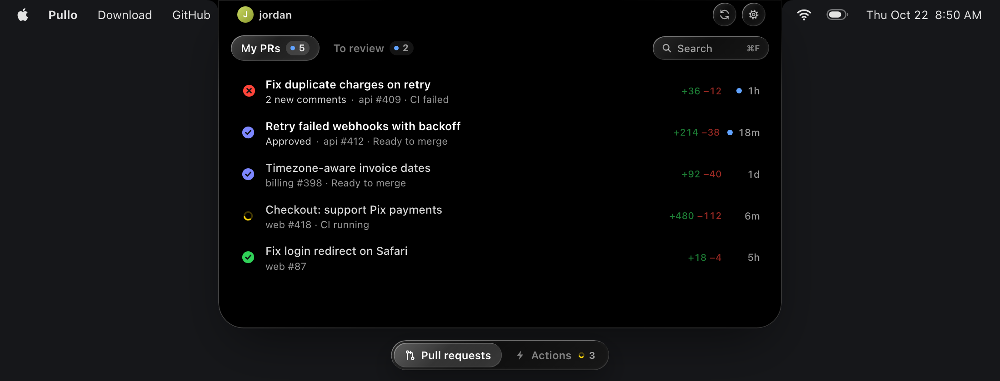
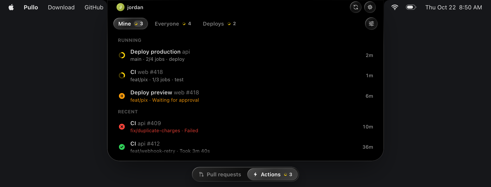
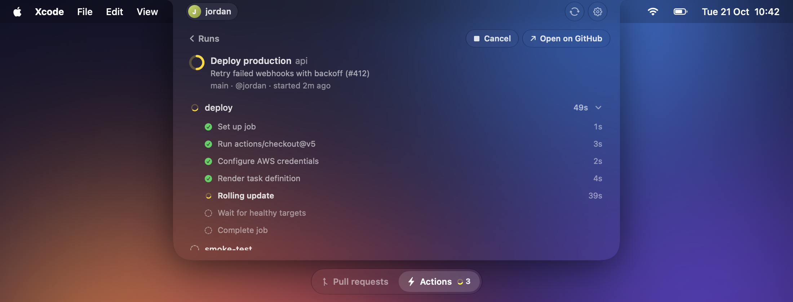

  

<h1 align="center">Pullo</h1>

  <b>Your pull requests and GitHub Actions, right in the notch.</b>

  

  <a href="https://pullo.jrdan.dev">pullo.jrdan.dev</a> · Free and open source · macOS 14 or later · Apple silicon · English, Português, Español

  

## Know the moment something changes

CI results, approvals, comments and review requests slide out of the notch, then get out of the way.

  

## Keep an eye on your Actions

What's running, what's waiting for approval and what just failed, with your deploys one click away.

  

## Every job, every step

Open a run to follow each step live. Re-run what failed, cancel what's stuck, or jump to the log on GitHub.

  

## Made to fit how you work

- **Your own tabs** for pull requests and runs, written like a GitHub search
- **All your accounts**, each with its own list
- **Liquid Glass** or Solid, to match your Mac
- **<kbd>⌥</kbd> <kbd>⌘</kbd> <kbd>P</kbd>** from any app, and the keyboard for everything else

## Get started

1. Download [`Pullo.dmg`](https://github.com/jordan-cod/pullo/releases/latest/download/Pullo.dmg) and drag Pullo to Applications.
2. Log in with the [GitHub CLI](https://cli.github.com): `brew install gh && gh auth login`
3. Open Pullo and hover over the notch.

## Private by design

Pullo talks to the GitHub API straight from your Mac. It borrows the token from `gh` when it needs it and never stores it. There's no server and no sign-up, and it only changes something on GitHub when you ask, like re-running a job.

<b>FAQ</b>

**Can I try new features early?**
Turn on **Get beta versions** in Settings → Updates.

**My Mac has no notch.**
Pullo sits at the top center of the menu bar instead. Hover there.

**How do I add another account?**
Run `gh auth login` with it, then add it in Settings → Accounts.

**I had DevNotch.**
It's the same app, renamed. It updates to Pullo by itself, and your settings come along.

  <a href="CHANGELOG.md">Changelog</a> · <a href="LICENSE">MIT License</a>

