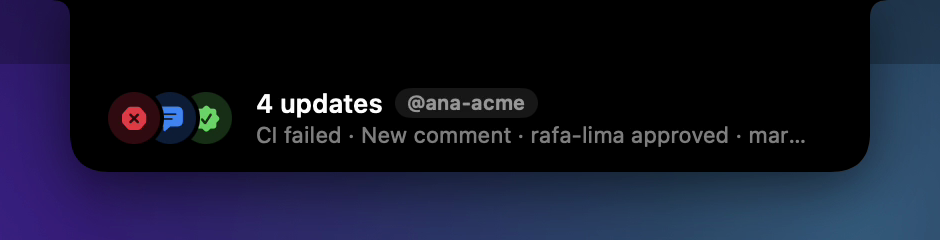
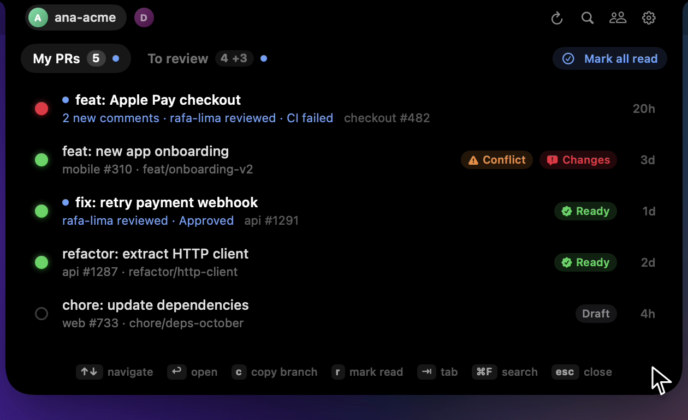
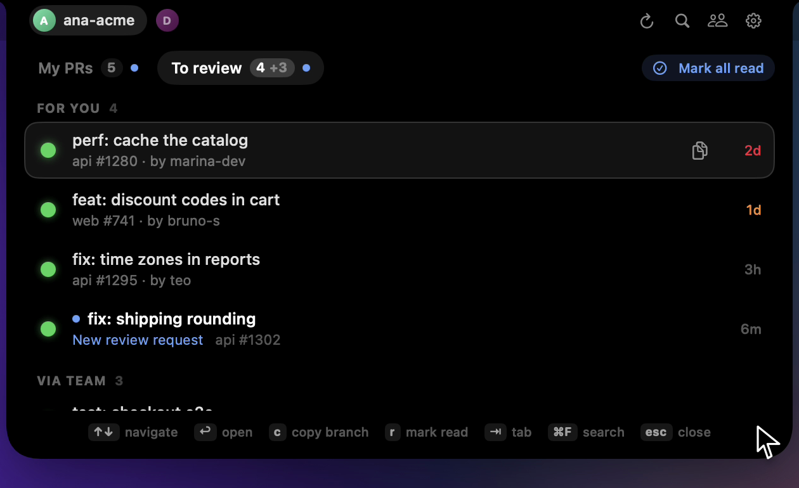
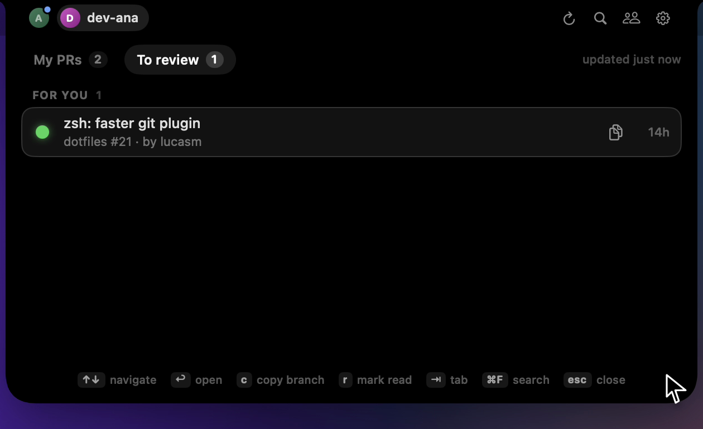
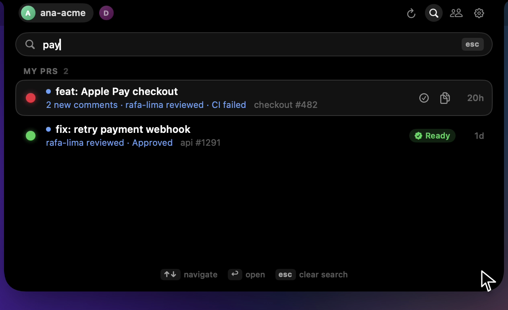

# DevNotch

DevNotch is a macOS app that puts your GitHub pull requests in the notch. It lets you know when CI fails, when someone approves or comments, and when your review is requested.


Requires macOS 14 or later and the [GitHub CLI](https://cli.github.com).

## Features

- Your pull requests and review requests in one list
- Review requests split between direct and team requests
- Alerts for CI, approvals, requested changes, comments and review requests
- Unread marker on each pull request, with what changed
- Failed checks with a link to the logs
- Multiple GitHub accounts, each with its own list
- Search by title, repo, number, branch or author
- Global shortcut and keyboard navigation
- Read-only: it doesn't approve, merge or store tokens

## Installation

1. Download `DevNotch.zip` from the [latest release](https://github.com/jordan-cod/devnotch/releases/latest).
2. Unzip it and move `DevNotch.app` to your Applications folder.
3. If you don't have the GitHub CLI yet, install it and log in:

   ```sh
   brew install gh
   gh auth login
   ```

DevNotch isn't notarized by Apple yet, so macOS blocks it the first time you open it. To allow it, run:

```sh
xattr -dr com.apple.quarantine /Applications/DevNotch.app
```

Or try to open the app, then go to **System Settings › Privacy & Security** and click **Open Anyway**.

## Usage

1. Open DevNotch and hover over the notch.
2. Pick which `gh` accounts to add.
3. Hover over the notch to see your pull requests, or press <kbd>⌥</kbd> <kbd>⌘</kbd> <kbd>P</kbd> from any app.
4. Click a pull request to open it in your browser. Opening it marks it as read.
5. Click the gear to change alerts, trackpad feedback and "Open at login".

| Shortcut | Action |
|---|---|
| <kbd>⌥</kbd> <kbd>⌘</kbd> <kbd>P</kbd> | Open or close the panel |
| <kbd>⌘</kbd> <kbd>F</kbd> | Search |
| <kbd>↑</kbd> <kbd>↓</kbd> | Move through the list |
| <kbd>↩</kbd> | Open the pull request |
| <kbd>C</kbd> | Copy the branch name |
| <kbd>R</kbd> | Mark as read |
| <kbd>⇥</kbd> | Switch tabs |
| <kbd>⌘</kbd> <kbd>1</kbd>…<kbd>9</kbd> | Switch accounts |
| <kbd>esc</kbd> | Close search or the panel |

## Screenshots

#### Alerts that arrive together are grouped



#### Your pull requests, with what changed since you last looked



#### Direct and team review requests



#### One list per account



#### Search



## FAQ

### Why does it need the GitHub CLI?

So it never has to store a token. DevNotch asks `gh` for a token on each refresh and keeps it in memory only. There's no server and no sign-up: the app talks to the GitHub API directly.

### How do I add another account?

Run `gh auth login` with the other account, then add it from the accounts button in the panel.

### Does it work on Macs without a notch?

Yes. The panel sits at the top center of the main screen.

### How often does it refresh?

Every minute, and right after your Mac wakes up. There's also a refresh button in the panel.

### What counts as an update?

Comments, reviews, changes to CI or the review decision, and new commits on other people's pull requests. Your own activity and bot activity don't count. Read state is stored only on your Mac.
